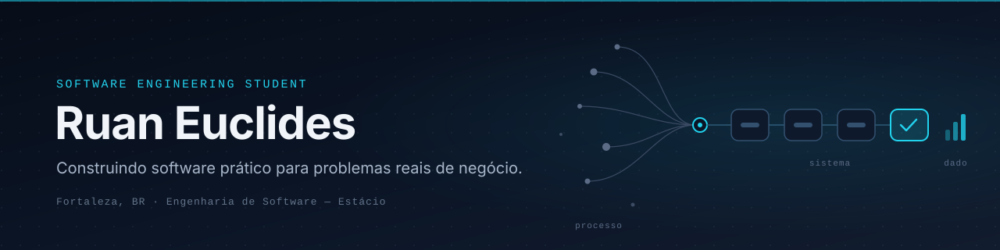

  

  
  
  

## About me

Sou estudante de **Engenharia de Software na Estácio** (conclusão prevista para 2028) e trabalho como **assistente administrativo** na Ativa Representações, uma distribuidora de autopeças que vende por meio de representantes comerciais.

No dia a dia lido com pedidos, cotações, conferência de dados e rotinas operacionais. Foi nesse contexto que comecei a programar com um objetivo claro: **transformar processos manuais em sistemas simples, confiáveis e úteis** para quem usa.

Tenho mais interesse em sistemas internos, automação de processos, dashboards, integrações entre sistemas e IA aplicada a negócios.

## Featured project

### ATIVA HUB · gestão de pedidos e vendas externas

> Projeto profissional · código privado (propriedade da empresa) · implantado na Vercel

**Problema.** Os pedidos dos representantes eram revisados manualmente contra a tabela de preços, as aprovações dos clientes aconteciam por e-mail e não havia acompanhamento depois do envio à indústria.

**O que eu construí.** Uma aplicação web responsiva (uso em celular e desktop) com duas visões, **representante** e **administração**:

- Autenticação com perfis de acesso por papel
- Cadastros (clientes, fábricas, produtos, arquivos) com histórico completo de pedidos por cliente
- Dashboards de vendas por cliente e análises consolidadas para a administração
- Digitalização de pedidos por foto: a IA extrai os itens e o pedido entra numa fila de aprovação do administrador
- Assistente com IA (Claude API), com entrada e saída por voz em português
- Importação de planilhas Excel com reconhecimento flexível de colunas, e exportação

**Stack:** Supabase (PostgreSQL) · Claude API · Vercel

**Minha contribuição:** levantamento do processo, modelagem, desenvolvimento e implantação, como desenvolvedor único.

## Tech stack

| Nível | Tecnologias |
| --- | --- |
| **Já utilizei** | HTML · CSS · Supabase / PostgreSQL · Claude API · Vercel · Git & GitHub · Excel |
| **Estudando** | JavaScript · React · SQL · Modelagem de dados |
| **Idiomas** | Português (nativo) · Inglês e Japonês (estudando) |

## Engineering mindset

O que procuro praticar em cada projeto, e onde quero evoluir:

- **Entender o processo antes do código.** Mapear quem usa, onde o fluxo trava e o que precisa ser medido.
- **Modelagem de dados** como base para relatórios e integrações confiáveis.
- **Código legível e manutenível**, com nomes claros e responsabilidades separadas.
- **Integração entre sistemas** (planilhas, APIs, bancos) para eliminar retrabalho.
- **Testes e documentação**: a próxima etapa que estou incorporando aos projetos públicos.

## Currently building & learning

- **Construindo:** pipeline de status do pedido no ATIVA HUB, do recebimento até o faturamento e a entrega
- **Planejando:** portfólio público com um sistema de gestão de pedidos e um dashboard comercial, usando dados fictícios, testes e documentação
- **Estudando:** graduação em Engenharia de Software (Estácio, conclusão em 2028), JavaScript, React, SQL, inglês e japonês

## Let's connect

Gosto de conversar sobre automação de processos, sistemas internos e como a tecnologia pode simplificar a operação de pequenas e médias empresas. Se você trabalha com isso, ou tem uma vaga de estágio ou júnior em que essa experiência faça sentido, será um prazer conversar.

  <a href="https://www.linkedin.com/in/ruan-euclides-8a455b216/">LinkedIn</a> ·
  <a href="mailto:ruaneuclides18@gmail.com">ruaneuclides18@gmail.com</a>

